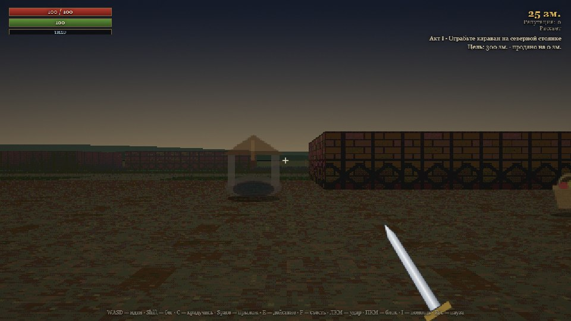
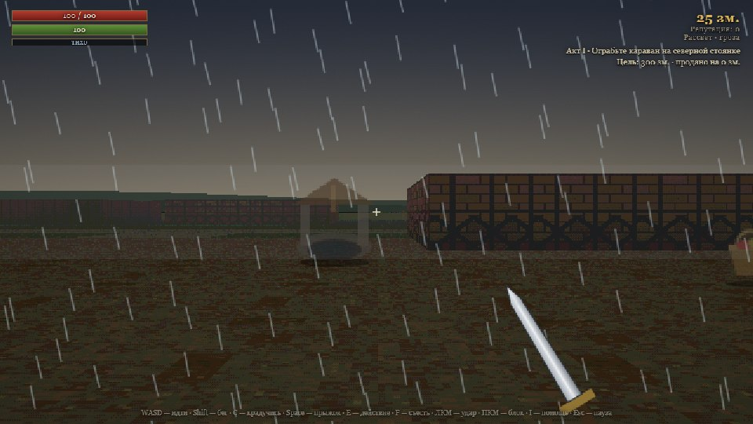
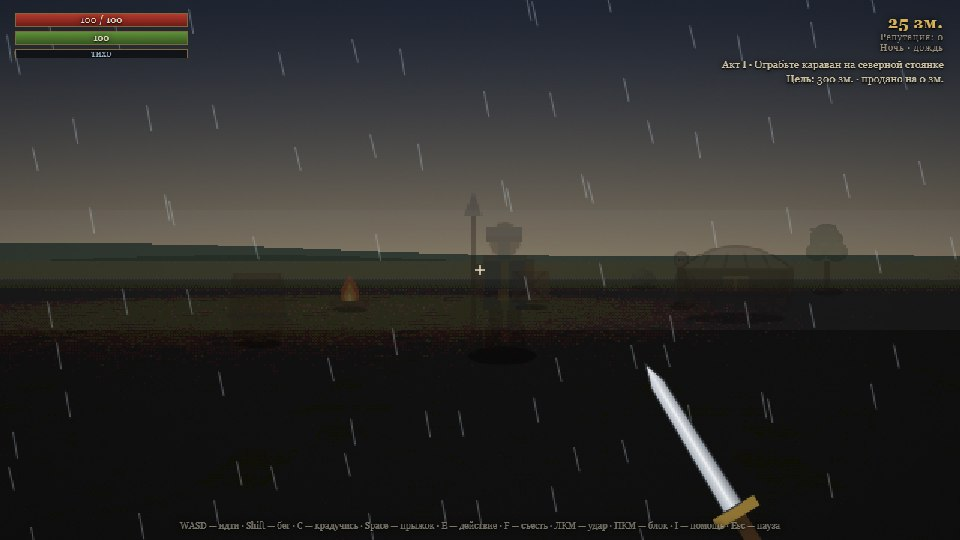
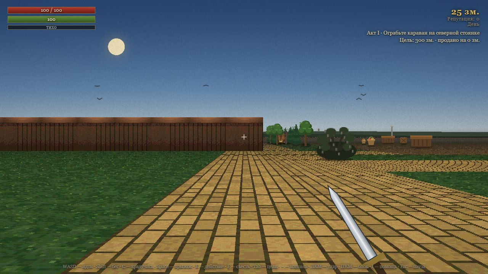

# Корованы: Тёмная дорога

[](#статус-проекта)
[](#статус-проекта)
[](#запуск)
[](LICENSE)

Браузерный рейкастер в духе Daggerfall: псевдо-3D от первого лица, деревня, тракт, караваны, которые можно обчистить. Без сборки, без зависимостей, без внешних ассетов — только ES-модули и Canvas 2D. Вся графика и звук генерируются кодом.



## Статус проекта

> **Это сырой прототип. Бета. Играть можно, но это не готовая игра.**

Честно о том, что это значит:

- **Баланс не отлажен.** Экономика, цены, здоровье и урон подобраны на глаз. Числа будут меняться.
- **Механики неполные.** Часть задуманного не реализована, часть реализована наполовину.
- **Сохранения могут ломаться между версиями.** Схема сейва имеет версию (`corovans.save.v1`), при несовпадении старый ран отбрасывается. Не рассчитывайте сохранить прогресс навсегда.
- **Нет мобильного управления, нет геймпада, нет локализации** — только клавиатура, мышь и русский язык.
- **Графика процедурная и намеренно грубая.** Это стилизация под 1996 год, а не отсутствие художника.
- **API и структура модулей меняются без предупреждения.** Это прототип, а не библиотека.

Если нашли баг — это ожидаемо, заводите issue. Если что-то не нравится по геймплею — тоже пишите, но помните, что приоритеты могут не совпасть с вашими.

## Скриншоты

| Деревня днём | Фахверк под дождём |
|---|---|
|  |  |

| Ночь на стоянке | Тракт |
|---|---|
|  |  |

## Запуск

Нужен Node.js 18+ (для dev-сервера и тестов) и современный браузер.

```bash
npm start
```

Откройте <http://localhost:8000>. Сервер (`scripts/serve.mjs`) отдаёт файлы с `Cache-Control: no-store`, поэтому правки видны без жёсткой перезагрузки.

Альтернатива, если Node недоступен:

```bash
npm run start:python
```

У неё есть подвох: `python -m http.server` не шлёт заголовков кеширования, и Chrome может держать старые ES-модули в кеше (в ответах появляется `304`). Тогда HTML обновляется, а логика игры остаётся старой. Лечится `Ctrl+Shift+R`, но лучше использовать `npm start`.

Запускать через `file://` нельзя: браузер заблокирует ES-модули.

## Сборка для Windows

Браузерная версия не требует зависимостей вообще. Для настольного окна есть два пути.

### Основной: WebView2, 24 МБ

Игра открывается в системном WebView2 (он есть в Windows 10/11 вместе с Edge), а не в собственном Chromium. Поэтому бинарник **24 МБ вместо 250**.

Первый запуск (сам поставит зависимости, ~5 МБ):

```bash
npm run desktop:setup
```

Дальше просто:

```bash
npm run desktop
```

Или двойным кликом по `Корованы.cmd` — он при первом запуске сам создаст окружение.

Готовый `.exe` (Nuitka, несколько минут):

```bash
npm run desktop:build
```

Появится `dist-desktop/Corovans.exe` — **один файл 24 МБ**, установка не нужна. Python и WebView2 на целевой машине не требуются: Python упакован внутрь, WebView2 есть в системе.

Что проверено на собранном exe: окно 1300×790, стартовый экран, 36 кадров в секунду, захват мыши (`pointer lock`) работает, поворот камеры работает, `localStorage` для чекпоинтов работает.

Отладка: `$env:COROVANS_DEBUG="1"` перед запуском — включает консоль сервера, инструменты разработчика и подробные ошибки.

### Запасной: Electron

```bash
npm install
npm run electron
```

Откроется отдельное окно ровно 1280×720, пиксель в пиксель с буфером игры. `F11` — полный экран, `F12` — инструменты разработчика. Готовый `.exe` — `npm run dist`: папка около 250 МБ.

Игра внутри Electron отдаётся не с диска напрямую, а через собственный протокол `app://`: по `file://` браузер блокирует ES-модули, и окно осталось бы пустым. В десктопной сборке на WebView2 ту же роль играет локальный HTTP-сервер на `127.0.0.1` со случайным портом — сохранения работают так же.

## Управление

| Клавиша | Действие |
| --- | --- |
| `WASD` | движение |
| мышь | обзор (клик по экрану захватывает курсор) |
| мышь по вертикали | наклон обзора |
| `Shift` | бег, тратит выносливость |
| `C` | красться (удержание) |
| `Space` | прыжок |
| `E` | взаимодействие; у фургона — удерживать для обыска |
| `F` | съесть лучшую еду из инвентаря |
| `E` | сесть на лошадь; верхом — спешиться |
| `H` | спешиться |
| `ЛКМ` | удар мечом |
| `ПКМ` | блок, тратит выносливость |
| `I` | помощь |
| `Tab` | панель целей и советов |
| `~` | консоль разработчика |
| `Esc` | пауза / освободить курсор |

`Ctrl` не используется намеренно: `Ctrl+W` закрывает вкладку в браузере, и это не отменяется через `preventDefault`.

## Цикл игры

1. Выйдите из деревни на восток по тракту, затем поверните на север к стоянке каравана.
2. Подкрадитесь к фургону и удерживайте `E` либо перебейте охрану.
3. Выберите, что унести: лимит веса не резиновый.
4. Вернитесь к скупщику Мардо, продайте добычу, купите улучшение и возьмите заказ.
5. Следующий караван приедет через несколько секунд, с более сильной охраной.
6. Три акта: **300 → 800 → 1500** золотых. Демо пройдено на третьем.

Кражу можно провернуть скрытно: приседание уменьшает дальность обнаружения, фургон, деревья и камни перекрывают стражникам обзор. Над головой стража видна полоска подозрения — зелёная, жёлтая, красная. Если вас заметили, прогресс обыска не сбрасывается, но охрана начнёт атаковать и запомнит, где вас видела в последний раз.

## Механики

- **Стиль игры.** Игра считает, как вы отыгрываете: тихие кражи, убийства, крупные сделки. Это определяет, каким вас знают — **Призрак**, **Мясник** или **Делец** — и какой лагерь вас ждёт: ночёвка со спящим стражем, укреплённый пост или двойной фургон. Панель «Слава» в HUD показывает текущий стиль и что он меняет. Множители зажаты в узких пределах: игра не наказывает за мастерство.
- **Контракты.** У Мардо доска из трёх заказов, берётся один, остальные сгорают. Типы: без крови, не на глаза, до рассвета, добыть конкретный тюк, убрать возницу. Награда — золото и репутация.
- **Репутация и мета-прогресс.** Репутация копится за контракты и тихие кражи и тратится на постоянные разблокировки: отмычки со старта, тайник (+4 к весу), свой скупщик (+10% к цене), лошадь, знание карты.
- **Сутки.** Цикл 240 секунд: рассвет, день, закат, ночь. Ночью темнее, стража видит хуже, но товар дороже.
- **Живность.** По полям и руинам бродят коровы, козы и лисы. Коровы и козы убегают и дают мясо (`F` — съесть, +20…30 здоровья), лиса нападает: укус наносит урон и оставляет кровотечение, которое тикает само в течение 12 секунд. За убийство животного розыск **не** начисляется. Живность обновляется вместе с караваном.
- **Куртизанки.** В мире четыре куртизанки: на площади, у корчмы, в лесной сторожке и на стоянке каравана. У каждой свой характер, внешность и цена. Открывается панель диалога: приветствие, три действия — заплатить, спросить слух, уйти. **Дважды заплатил — дальше принимает бесплатно**, но бесплатный визит лечит только здоровье, без запаса бодрости. Привязанность запоминается по месту и переживает смену каравана.
- **Гражданские.** По деревне и тракту ходят шесть небоевых NPC: крестьянка, крестьянин, торговка зеленью, пьяница у корчмы, нищий и путник. С каждым можно поговорить (`E`) — у каждого свой пул фраз. Нищий принимает монету и даёт репутацию.
- **Титан.** По карте медленно ходит неубиваемое чудовище: клинок от него отскакивает. Оно ест стражу, возниц, гражданских, животных и вас — но не Мардо и не куртизанок. От него нельзя убежать навсегда и нельзя спрятаться. Единственный выход — **заговорить** (`E`) и ответить на три вопроса. Правильные ответы — честные, а не хитрые. Прошли все три — он больше не тронет вас до конца забега. Ошиблись — он съедает, и забег начинается с нуля (репутация и разблокировки целы).
- **Лошадь.** У конюшни стоит лошадь: `E` — сесть, `H` — спешиться. По дороге она вдвое быстрее пешехода, по бездорожью — в полтора раза. Верхом нельзя приседать, блокировать и обыскивать фургон; удар с седла слабее. Разблокировка «Лошадь» в репутации добавляет личную лошадь у спавна. В кадре от первого лица видна голова и шея, камера поднята.
- **Запас бодрости.** Сверх 100 HP можно получить до 25 единиц запаса. Он принимает урон первым и медленно тает на ходу (но не в бою и не на паузе). Еда запас не восстанавливает.
- **Мир.** Карта 200×200. Деревня с фахверковыми домами и площадью, тракт из жёлтого кирпича на восток, поворот на север к стойбищу, поля, лес, руины и вода. Восточнее — **готический собор** с двумя девятиярусными башнями, витражами и контрфорсами, **ратуша** в духе Тауэра с зубцами и замковой кладкой, рыночная площадь и квартал хижин с переулками. В сараи, часовню, руины, собор и ратушу можно заходить внутрь; жилые дома сплошные. Высокие здания рисуются выше остальных: у каждой стены свой множитель высоты.
- **Обнаружение.** Стражники видят в пределах радиуса и конуса обзора, учитывают приседание, бег и шум. Потеряв игрока, они идут к последней известной точке и ищут там, затем возвращаются на пост.
- **Обыск фургона.** Удержание `E` в радиусе 2.5; отмычки сокращают время. После вскрытия открывается выбор добычи: берите столько, сколько унесёте.
- **Бой.** ПКМ держит блок: гасит 75% урона, работает только спереди и тратит выносливость. На пустой полоске блок пробивается и пропускает больше. Пока держите блок, удар недоступен, а движение замедлено.
- **Прыжок.** `Space` поднимает камеру, но приземление слышно — это будит стражу.
- **Экономика.** Товары имеют вес и цену; скупщик продаёт улучшения (меч, броня, отмычки, сапоги) и принимает штраф.
- **Смерть.** Мягкая: вы очнётесь у Мардо, потеряв 20% золота и всю переносимую добычу. Активный контракт провален. Репутация, разблокировки и статистика сохраняются.

## Графика и погода

- Дизеринг Байера, зерно и виньетка — стилизация под 256-цветную эпоху.
- Лайтмап с точечными источниками: костёр в лагере, факелы у домов, окна корчмы. Ночью видно только то, что освещено.
- Фахверковые фасады: кирпич и штукатурка с тёмным дубовым каркасом.
- Целочисленный масштаб картинки: буфер 1280×720, на экране — кратное увеличение, пиксели квадратные и резкие, по краям чёрные поля.
- Дождь и снег выводятся из сида забега: в одном сухо, в другом моросит, в третьем гроза или метёт снег. Перезагрузка с чекпоинта даёт ту же погоду. Снег падает медленно и качается, дождь идёт штрихами.

## Цели и советы

`Tab` открывает панель: что делать прямо сейчас, прогресс к цели акта и до трёх советов по ситуации — мало здоровья, розыск, бесплатный визит к куртизанке, близость каравана.

## Консоль разработчика

`~` открывает консоль. Команды: `tgm` (бессмертие), `god on|off`, `gold N`, `hp N`, `heal`, `tp X Y`, `tier N`, `act N`, `wanted N`, `weather clear|drizzle|rain|storm|snow`, `speed N`, `noclip`, `kit`, `help`. История — стрелками вверх/вниз.

**Консоль доступна всегда и обходит баланс.** Это прототип, отлаживать нужно, но если хочется честной игры — не открывайте её.

## Сохранения и чекпоинты

Один автослот в `localStorage` (`corovans.save.v1`). Сохранение происходит автоматически в безопасных точках: старт забега, продажа добычи, новый караван, взятие и сдача контракта, смена акта, смерть. На стартовом экране появляется кнопка «Продолжить».

Позиции и здоровье стражников **не** сохраняются: лагерь пересоздаётся по сиду и архетипу. Поэтому реролл лагеря перезагрузкой невозможен, как и возврат золота после смерти.

## Разработка

```bash
npm run verify
```

Команда выполняет `node --check` для всех модулей и запускает `node --test` (109 тестов). Отдельный файл:

```bash
node --test tests/systems.test.js
```

Браузерного тест-раннера в репозитории нет. Для отладки откройте игру с `?debug=1` — в `window.__corovans` будут доступны `game`, `run`, `profile`, `ui`, `input`, `player`, `world`, `renderer`, `saveCheckpoint` и отладочные наборы модулей.

Метка сборки пишется в консоль при загрузке (`[corovans] build ...`) и доступна как `window.__corovans.build`. Если цифра не совпадает с ожидаемой — браузер отдал закешированный модуль.

### Структура

```
index.html, styles.css     интерфейс и HUD
src/main.js                состояние рана, цикл, взаимодействия, экономика, сохранения
src/run.js                 снапшот/восстановление рана, чекпоинты, акты, штраф смерти
src/world.js               карта 200×200, зоны, коллизии, обзор, актёры, лагеря
src/ray.js                 DDA одного луча, геометрия стен (чистый)
src/raycaster.js           стены, пол, спрайты, меч, дождь, подозрение, свет
src/horse.js               лошадь: посадка, скорость, запреты (чистый)
src/dither.js              дизеринг, зерно, виньетка, AO (чистый)
src/lighting.js            лайтмап, источники света, мерцание (чистый)
src/weather.js             дождь и снег из сида рана (чистый)
src/cheats.js              консоль разработчика (чистый)
src/advice.js              цели и советы по ситуации (чистый)
src/courtesan-sprite.js    четыре стиля куртизанок, 96×184, общий рендер головы
src/person.js              гражданские, стража, возница и Мардо, 96×184
src/intro.js               заставки: старт, смерть, победа (чистый)
src/titan.js               титан: движение, поедание, вопросы (чистый)
src/titan-sprite.js        спрайт титана, 140×260
src/motion.js              физика прыжка и наклон камеры (чистый)
src/player.js              движение, выносливость, приседание, прыжок, блок
src/enemies.js             ИИ стражников и возницы, память о последней точке
src/style.js               телеметрия стиля и тюнинг мира под него (чистый)
src/contracts.js           генерация и проверка контрактов (чистый)
src/profile.js             мета-прогресс, разблокировки, миграция сейвов (чистый)
src/save.js                обёртка над localStorage
src/daynight.js            фазы суток (чистый)
src/rng.js                 детерминированный ГПСЧ (чистый)
src/wildlife.js            коровы, козы, лисы, добыча, кровотечение (чистый)
src/npc.js                 вариант куртизанки по сиду (чистый)
src/inventory.js           инвентарь, вес, таблица добычи (чистый)
src/economy.js             цены, улучшения, штраф (чистый)
src/combat.js              урон, конус удара, блок, кулдауны (чистый)
src/ui.js                  DOM-панели, HUD, торговля, контракты, добыча
src/audio.js               синтезированный звук через WebAudio
src/textures.js            процедурные текстуры
src/sprites.js             процедурные спрайты
tests/                     unit-тесты на node:test
scripts/check.mjs          синтаксическая проверка модулей
scripts/serve.mjs          dev-сервер с Cache-Control: no-store
docs/screenshots/          скриншоты для README
```

## Известные ограничения

- Одна карта, три акта.
- Нет магии, создания персонажа, инвентаря-сетки, торговли предметами по одному.
- Нет мобильного управления и геймпада.
- Нет внешних ассетов: всё рисуется и синтезируется кодом.
- Тестов на рендер нет; визуальные регрессии ловятся скриншотами вручную.

## Участие

Проект в стадии прототипа: Pull Request'ы приветствуются, но крупные изменения лучше сначала обсудить в issue. Перед отправкой прогоните `npm run verify`.

## Лицензия

[MIT](LICENSE). Делайте что хотите, только не приписывайте авторство себе.
